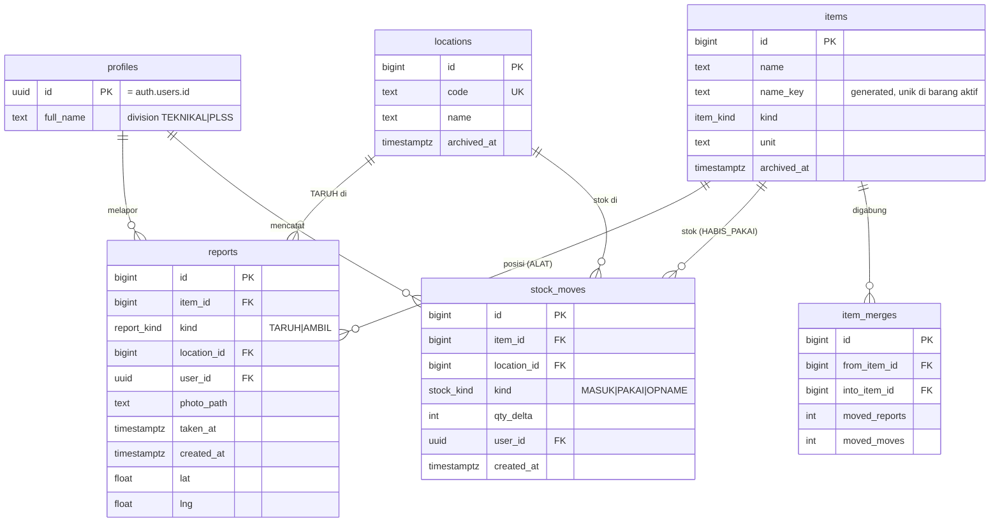

# Bengkel Anargya

PWA untuk mencatat **di mana barang bengkel berada**. Anak teknikal cukup memfoto barang, mengisi nama, lalu memilih **Taruh** atau **Ambil**. Waktu, lokasi rak terakhir, dan GPS terisi otomatis. PLSS bisa melihat posisi setiap alat, siapa yang memegangnya, dan sisa stok bahan habis pakai.

Dibuat untuk penilaian backend internship Web Development Anargya ITS EV Team.

- Desain: Figma, page **"Bengkel Anargya: Mobile"** (`https://www.figma.com/design/dAypXrqoA5G3zaGGk71ldJ?node-id=306-24`)
- Stack: Next.js 15 (App Router) · Supabase (Postgres, Auth, Storage) · Tailwind v4 · shadcn/ui · PWA

## Masalah dan solusinya

| Masalah | Solusi |
|---|---|
| Teknikal lupa menaruh barang di mana | Setiap barang yang ditaruh **wajib difoto** di lokasinya. Lokasi default diambil dari rak yang terakhir dipakai di HP itu, jadi biasanya tinggal kirim. |
| PLSS harus mencari barang | Halaman **Cari** menampilkan posisi terakhir, siapa yang menaruh, dan kapan, lengkap dengan foto. |
| Barang dibawa terlalu lama | Halaman **Dipegang** memberi tanda pada alat yang dipegang lebih dari **12 jam**. |
| Stok bahan tidak jelas | Barang habis pakai dicatat lewat mutasi (masuk, pakai, opname). Sisa stok dihitung dari riwayat. |

## Manajemen data (inti penilaian)

### Model



### Keputusan utama

1. **Riwayat adalah sumber kebenaran.** Tidak ada kolom `posisi_sekarang` atau `stok` yang disimpan. Posisi alat = laporan terbaru (`item_positions`, `DISTINCT ON` + index `(item_id, created_at desc)`). Stok = `SUM(qty_delta)` (`stock_levels`). Angka tidak bisa melenceng dari riwayatnya.
2. **Riwayat append-only.** Trigger `tg_history_append_only` menolak `UPDATE`/`DELETE` pada `reports` dan `stock_moves`. Satu-satunya pengecualian adalah pemindahan `item_id` saat PLSS menggabungkan barang duplikat, dan setiap penggabungan dicatat di `item_merges`. Barang dan lokasi tidak dihapus, hanya diarsip (`archived_at`).
3. **Tulis hanya lewat RPC.** Klien tidak punya izin `INSERT/UPDATE/DELETE` ke tabel riwayat. Semua penulisan lewat `report_item` dan `move_stock` (`SECURITY DEFINER`), yang:
   - memvalidasi waktu foto (tidak di masa depan, tidak lebih dari 7 hari),
   - memastikan foto ada di Storage dan berada di folder milik pelapor,
   - menormalkan nama barang (`"Kunci  Ring 10"` = `"kunci ring 10"`) lewat kolom generated `name_key` + unique index parsial,
   - **mengunci baris barang** (`SELECT ... FOR UPDATE`) sehingga dua laporan bersamaan untuk barang yang sama diproses berurutan.
4. **Constraint di database, bukan hanya di UI.**
   - `TARUH` wajib punya lokasi dan foto, `AMBIL` tidak boleh punya lokasi (`CHECK`).
   - `MASUK` harus positif, `PAKAI` negatif (`CHECK delta_sign`).
   - Laporan posisi hanya untuk `ALAT`, mutasi stok hanya untuk `HABIS_PAKAI` (trigger `tg_check_item_kind`).
   - Stok tidak boleh minus. Dicek di dalam transaksi yang sudah mengunci barang. Sudah diuji dengan dua sesi paralel.
   - Kode lokasi berformat `RAK-A1` (`CHECK` regex), unik.
5. **Dua jam.** `taken_at` = jam di HP (kapan foto diambil), `created_at` = jam server. Urutan memakai jam server karena jam HP bisa salah. Keduanya disimpan.
6. **Hak akses (RLS).**
   - Tamu (`anon`): tidak bisa membaca atau memanggil apa pun.
   - Anggota: bisa membaca semua (tujuannya transparansi posisi barang), menulis lewat RPC.
   - PLSS: menambah stok, opname, gabung/arsip/ganti nama barang, kelola lokasi, kelola anggota, ekspor CSV.
   - Divisi diambil dari `app_metadata` (hanya bisa diisi admin), bukan `user_metadata` yang bisa diisi pengguna.
   - Foto: bucket privat, unggah hanya ke `photos/<uid>/`, tidak bisa diganti atau dihapus. Ditampilkan lewat signed URL 1 jam.
7. **Opname tidak menimpa angka.** PLSS memasukkan hasil hitung fisik, lalu selisihnya dicatat sebagai mutasi `OPNAME`. Riwayat lama tetap utuh.
8. **Ekspor CSV** aman dari formula injection (sel yang diawali `= + - @` diberi awalan `'`).

### Tes

`supabase/tests/run_tests.sh` menjalankan migrasi di Postgres biasa (dengan tiruan skema `auth`/`storage`), lalu menguji 29 skenario: izin, constraint, normalisasi nama, append-only, opname, merge, dan **konkurensi** (dua sesi memakai 100 dari sisa 125 bersamaan → tepat satu yang berhasil, sisa 25).

```bash
PGHOST=<host> PGPORT=<port> bash supabase/tests/run_tests.sh
```

## Menjalankan

### 1. Supabase
1. **SQL Editor**: jalankan isi kedua migrasi berurutan: `supabase/migrations/20261119000000_init.sql`, lalu `20261121000000_explicit_grants.sql`. Migrasi kedua wajib: sejak 30 Mei 2026 project Supabase baru tidak lagi memberi izin otomatis ke tabel `public` (changelog #45329, berlaku juga ke project lama mulai 30 Okt 2026). Tanpa itu login gagal dengan `permission denied for table profiles`.
2. **Authentication → Sign In / Providers → Email**: matikan *Allow new users to sign up* (akun dibuat oleh PLSS).
3. **Authentication → Users → Add user**: buat akun PLSS pertama (centang *Auto Confirm User*).
4. **SQL Editor**: jalankan `supabase/bootstrap.sql` (ganti email PLSS di dalamnya kalau berbeda). Skrip ini juga membuatkan profil untuk akun yang dibuat sebelum migrasi.
5. Opsional: `supabase/seed_demo.sql` untuk data demo.

### 2. Lokal
```bash
cp .env.example .env.local   # isi URL, publishable key, dan (opsional) secret key
npm install
npm run dev                  # http://localhost:3000
```

Kamera di HP butuh HTTPS. Untuk mencoba dari HP, pakai URL deploy Vercel.

### 3. Deploy (Vercel)
Import repo, isi env `NEXT_PUBLIC_SUPABASE_URL`, `NEXT_PUBLIC_SUPABASE_PUBLISHABLE_KEY`, dan `SUPABASE_SECRET_KEY` (hanya di Vercel, jangan di-commit).

## Struktur

```
supabase/
  migrations/…_init.sql   skema, constraint, trigger, RPC, view, RLS, storage
  migrations/…_explicit_grants.sql  GRANT eksplisit ke role authenticated (Data API)
  bootstrap.sql           jadikan akun pertama PLSS
  seed_admin.sql          buat / reset akun admin PLSS dari SQL Editor
  seed_demo.sql           data demo (opsional)
  tests/                  tes skema + konkurensi
src/
  app/(app)/(lapor)/      Lapor: page.tsx (kamera → form) + Reporter.tsx
  app/(app)/cari          cari barang
  app/(app)/barang/[id]   detail + riwayat
  app/(app)/dipegang      alat yang sedang dipegang (> 12 jam ditandai)
  app/(app)/stok          stok habis pakai
  app/(app)/akun          akun + menu PLSS (lokasi, barang, opname, anggota, ekspor)
  lib/                    klien Supabase, sesi, format waktu WIB, kompres foto
  middleware.ts           refresh sesi + arahkan tamu ke /login
public/sw.js              service worker (aset statis saja, data tidak di-cache)
```
